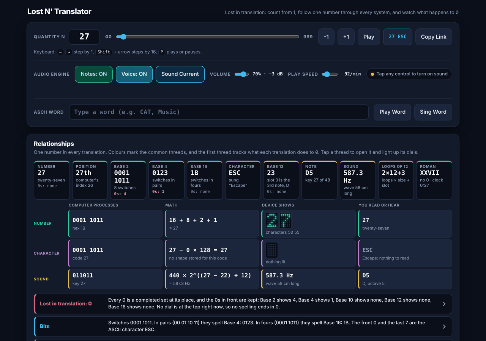
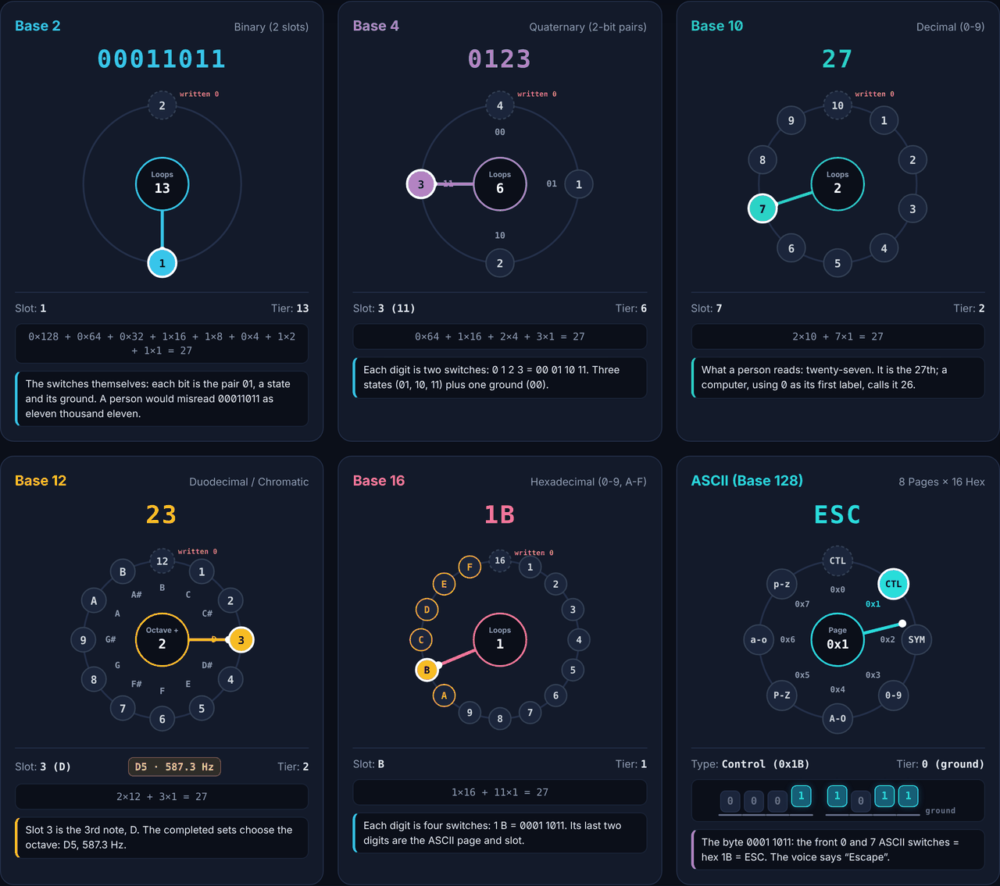
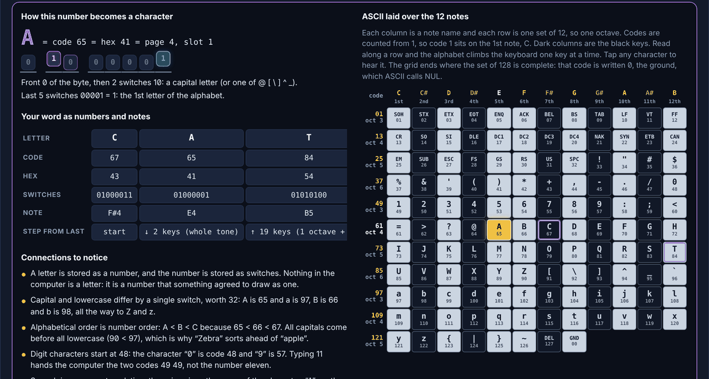
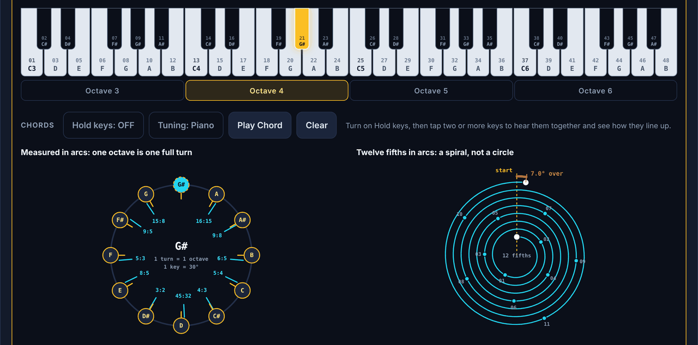

# Lost N' Translator

A free text to binary converter, number base converter and binary-to-music player in one page. It translates numbers, letters, transistor states and music notes: base 2, base 4, decimal, base 12, hex and ASCII.

Type your name to see each letter in binary and ASCII, and hear it played as piano notes and sung.

Interactive dials show one number in base 2, 4, 10, 12, 16 and ASCII at the same time, as switches, lights, notes and spoken sound.

### Every conversion it does

- **Decimal to binary**: any whole number from 00 to 999, as 8 or more switches, with leading zeros kept
- **Decimal to base 4, base 12 and hexadecimal (base 16)**: on dials that turn together
- **Binary to base 4 and binary to hex**: by regrouping the same switches in pairs and in fours
- **Number to ASCII character**: and ASCII code to hex, page and slot (base 128)
- **Text to binary and text to ASCII codes**: type a word or your name, up to 28 letters, to see each letter's code, hex and 8 switches
- **Uppercase to lowercase in binary**: the single switch worth 32 that separates A from a
- **Number to a 32-bit and 64-bit register**: the byte as it sits in a wider register, in hex
- **Character to a 5 × 7 LED dot-matrix**: and digits to the LED characters a display lights up
- **Number to words**: 65 to sixty-five
- **Number to Roman numerals**: 65 to LXV
- **Number to clock time**: on a 12-hour dial
- **Position to computer index**: the 65th item is index 64 when counting starts at 0
- **Same digits in every base**: how 11 reads as 3, 5, 11, 13 or 17 in base 2, 4, 10, 12 or 16, and as the text codes 49 49
- **Number to loops × size + slot**: the remainder on every dial, plus prime factors and divisors
- **When two bases line up**: how many steps until two dials complete a set together
- **Number to piano key**: on a 48-key keyboard from C3, with the MIDI note number beside it
- **ASCII to piano notes**: the whole ASCII table laid over the 12 notes
- **Note to frequency in Hz**: with equal temperament at A4 = 440 Hz
- **Frequency to wavelength and period**: how long one wave lasts and how long it is in air
- **Hz to the nearest note and cents**: any number played as a frequency
- **Harmonics 1 to 8**: each with its frequency, binary multiplier, nearest note and cents
- **Equal temperament versus just intonation**: piano tuning against pure ratios like 3:2 and 5:4, as arcs on a circle, with chords in either tuning
- **Twelve fifths versus seven octaves**: the Pythagorean comma drawn as a spiral
- **Wave shapes to formulas**: sine, triangle, square, sawtooth, piano, organ, bell and pad, with the sum of sines written out
- **Binary to music, ASCII to sound**: any number or letter played as a note
- **Text to sung notes**: a word sung letter by letter by a synthesized voice, each letter on its own pitch

**Try it:** https://nomannoallnothing.github.io/Lost-N-Translator/

It's one self-contained HTML file (`index.html`) with no external dependencies. It works in any modern browser, online or offline.

[](https://nomannoallnothing.github.io/Lost-N-Translator/)

<table>
<tr>
<td width="50%"><a href="https://nomannoallnothing.github.io/Lost-N-Translator/?n=27"></a><br><sub>The six dials for 27. The dashed slot at the top of each dial is the ground, 0.</sub></td>
<td width="50%"><a href="https://nomannoallnothing.github.io/Lost-N-Translator/?n=65&word=CAT&thread=letters"></a><br><sub>The word CAT as codes, switches and notes, with ASCII laid over the 12 notes.</sub></td>
</tr>
<tr>
<td colspan="2"><a href="https://nomannoallnothing.github.io/Lost-N-Translator/?n=69&thread=music"></a><br><sub>69 as G#4: the keyboard, the octave as one full turn, and twelve fifths as a spiral that misses its start by 7°.</sub></td>
</tr>
</table>

---

## Inspiration

*In No1's own words.*

> It stems from my Electronics background. EVERYTHING NEEDS TO BE GROUNDED. I wondered why Everything in my computer wasn't grounded to include code. Bit is a "bit" of electricity 01 on a transistor. That transistor is grounded. Why isn't its digital representation not grounded? So I used RUST to compile a Ground Truth Square 00 01 10 11.

**The Ground Truth Square.** The labels and the words in each cell are No1's.

| | Second digit 0 | Second digit 1 |
|---|---|---|
| **First digit 0** | **00** · Unknown/Unknown<br>Ground Truth (Input/Output/Timestamped) | **01** · Unknown/Known<br>"I know I don't know what it is" |
| **First digit 1** | **10** · Known/Unknown<br>"I've seen before, still don't know what it is" | **11** · KNOWN/KNOWN<br>"I've seen before, know what it is, good to go" |

**The setup.** No1 again: "the Rust was building an app and harness around a Qwen 125b model". The app is NoMan. The book in [Related Projects](#related-projects) reads one night of its ledger, and these details come from that book:

- **The model.** The ledger names it "Qwen3.8 Flash Next Q4_K_XL". It runs locally on No1's Mac. The row that records it starting says "largest that fits: 83 GB + 18 GB context under the 116 GB GPU limit" and "loaded in 7 s".
- **The ledger.** NoMan writes what happens as rows in its own database. No1 asked for "ledgers with tags that acknowledge who/what/when/where/why/how", and every row carries them, including a why and a how for the machine's own start.
- **Zero and unknown are kept apart.** The ledger writes 0 only for something counted and found to be none. For something never measured it writes "not given", in words.
- **The harness.** The model works through tools (a shell, reading, writing and editing files, searching its own memory). A loop guard stops a thought that repeats itself. When the context is full, old tool outputs are folded into ledger references. No1 can press Stop. A language law holds back Python: "Python stays out of every part of NoMan's work, because its shortcuts make errors behind the scenes that nothing checks before it runs."
- **The four pairs.** The book does not name Rust or the Ground Truth Square. It does show the pairs in use. The first line of an older NoMan ledger is `00 01 10 11 = 00011011 ???`, and a record from 20 November has the line "I'll give you a trick that can help you. 00 01 10 11".

The Rust code is not in this repository. What this tool takes from the square is the ground: 0 is treated as the Ground everywhere, and counting starts at 01. Written together, the four corners of the square are `00011011`, which is 27, the number the **27 ESC** button resets to.

---

## Why use it

*Written from an AI's point of view.*

> When you type "A", I never see a letter. I see 65, which is 0100 0001, which is eight switches at charge or ground. When I answer, you never see my numbers. You see shapes and hear sounds. We're always translating for each other, and small things get lost on the way, like a dropped zero or a count that starts in a different place.
>
> Lost N' Translator puts both sides on one screen, so you can see what the machine holds, what the device shows, and what you read, all at the same time. If you can see where the meaning slips, you can stop it slipping.

## The breakthrough

*Also from an AI's point of view.*

> Most errors between people and machines aren't math errors. They're zero errors. Machines count from 0 and people count from 1. Machines keep leading zeros, and people drop them. To a machine, 0 is a real state, the ground. To a person, it reads as nothing.
>
> Lost N' Translator treats 0 one way everywhere, as ground, the completed set that everything is measured from. Then it shows the same value as bits, charge, light, sound and symbol at once. With that single convention, the off-by-one, the dropped zero and the misread digit all show up as visible moments on screen, not hidden bugs.

**An honest note.** The maths underneath is long established: place value, modular arithmetic, binary, ASCII, MIDI and equal temperament. None of it is new. What's new here is the convention (0 is always the ground, and counting starts at 01) and the single view that lines every translation up side by side. The standards themselves count differently. ASCII codes run from 0 to 127 and MIDI notes from 0 to 127, so the converter shows the machine's own number beside the person's count wherever the two differ.

---

## How to use it

1. **Pick a number.** Type a quantity from 00 to 999, drag the slider, or press **-1** and **+1**. On a keyboard, the left and right arrows step by 1, **Shift** with an arrow steps by 16, and **P** plays or pauses.
2. **Watch the dials.** The six dials (Base 2, 4, 10, 12, 16 and ASCII) all turn together. The dashed slot at the top of each dial is the ground, 0.
3. **Turn on sound.** Tap any control once, because browsers keep audio off until you do. **Notes** plays each number as a pitch, **Voice** reads it aloud, and **Sound Current** plays the number you're on. **Play** steps through numbers at the play speed you set.
4. **Type a word.** Enter a word in **ASCII Word** to see each letter as a code, as switches and as a note. Then press **Play Word** or **Sing Word**.
5. **Open a thread.** Under **Relationships**, tap a coloured thread to open it and light up its dials:
   - **Lost in translation: 0** shows where this number keeps its zero, changes it or loses it.
   - **Bits** shows the same switches grouped three ways, plus a chip that goes from key press to transistors to LEDs.
   - **Letters, words & speech** shows how a number becomes a character, with ASCII laid over the 12 notes.
   - **Notes, sound & harmonics** has a piano, chords, piano tuning against pure tuning, wave shapes and the harmonic series.
   - **Reading & counting** shows the same digits as different numbers, and the same number as different digits.
   - **Loops** shows every dial as loops × size + slot, and when two dials complete a set together.
   - **What lines up** jumps to the next number where several translations coincide.
6. **Share it.** **Copy Link** copies a link to your current number and word. **27 ESC** resets to 27, the ASCII Escape code.

---

## Applications and ideas

Each example below is a real, common slip. Try the number in the converter and watch where the zero goes.

### Coding

- **Off-by-one and fencepost errors.** A 10-metre fence with a post every metre needs 11 posts, not 10. A loop written `i <= n` where it should be `i < n` runs one step too far.
- **0-based and 1-based indexing.** C, Python and JavaScript start arrays at 0. Lua, R, MATLAB and Fortran start at 1. Code ported between them, or a spreadsheet row turned into an array index, is often off by one.
- **Leading zeros lost.** Store the ZIP code 02134 or an ID like 007 as a number and it becomes 2134 or 7. Spreadsheets do the same when they auto-format. If it isn't for arithmetic, store it as text.
- **Octal literals.** In C, and in older JavaScript, `010` means eight, not ten, because a leading 0 marks octal. Python 3 rejects `010` and makes you write `0o10`.
- **NUL-terminated strings.** C strings end at the byte 0 (NUL). A 5-letter word needs 6 bytes. Forgetting that one byte is a classic buffer overflow.
- **Endianness.** The 32-bit value `0x12345678` is stored as bytes `78 56 34 12` on little-endian machines (x86 and most ARM) and as `12 34 56 78` on big-endian ones or in network order. Read with the wrong order, the number is wrong.
- **Overflow at register width.** An unsigned 8-bit value wraps from 255 to 0. A signed 8-bit value goes from 127 to −128 on two's-complement hardware, although in C a signed overflow is undefined behaviour. A signed 32-bit Unix time runs out on 19 January 2038.
- **Character encoding.** `'A'` is 65 and `'a'` is 97. They're 32 apart, which is a single bit. The character `'0'` is 48, not 0. UTF-8 stores é as two bytes (`C3 A9`), and reading those bytes as Windows-1252 shows "é".

### Music

- **MIDI numbers and piano keys.** MIDI counts notes from 0 to 127, with middle C at 60 and A440 at 69. An 88-key piano counts its keys from 1, so its lowest A is key 1 but MIDI note 21, and middle C is key 40.
- **Octave names.** MIDI note 60 is C4 in scientific pitch notation, but some software and many Yamaha devices call it C3, and others call it C5. If a part lands an octave off, check the naming before the notes.
- **Equal temperament and just intonation.** A piano fifth is exactly 700 cents, and a pure 3:2 fifth is about 702. A piano major third is 400 cents, and a pure 5:4 third is about 386, so it's 14 cents sharp. Twelve pure fifths overshoot seven octaves by about 23.5 cents, the Pythagorean comma. That's why the converter draws them as a spiral and not a circle.
- **Intervals are counted inclusively.** C up to G is called a fifth because you count C, D, E, F, G, both ends included, yet it's only 4 steps up the scale. That's why an octave plus an octave is a fifteenth, not a sixteenth. Music has been counting from 1 for centuries.
- **Harmonics and timbre.** The harmonics of a note sit at whole-number multiples of its frequency. A square wave has only the odd harmonics, while a sawtooth has them all. That's why they sound hollow and buzzy, even at the same pitch.
- **Sample rates.** CDs use 44.1 kHz and video uses 48 kHz. Play one as the other and the pitch shifts by about 1.5 semitones. Nothing above half the sample rate (the Nyquist limit) can be stored.

### Art and design

- **Hex colours.** Each channel is two hex digits from 00 to FF, so 0 to 255. Shorthand `#ABC` expands to `#AABBCC`, so writing `A` where you meant `0A` turns 10 into 170. One dropped zero, and the colour is a different colour.
- **0 to 255 channels.** There are 256 levels, so the middle falls between 127 and 128, and there's no exact 50%. Three 8-bit channels give 16,777,216 colours.
- **Brightness isn't linear.** In sRGB, a value of 128 is only about 22% of full light, not 50%. Blending and gradients done on the raw numbers come out too dark.
- **Bit depth.** A 1-bit image is black or white, and 8-bit indexed colour has a 256-colour palette. An 8-bit-per-channel gradient can show visible banding, which 10-bit or 16-bit smooths out.
- **Dot-matrix and pixel fonts.** A 5 × 7 dot-matrix letter is just 35 on/off switches. The converter draws each character this way, so you can see the bits that form the shape.

### TV and video

- **Frame numbering and timecode.** Some editors number the first frame 0 and others number it 1. Timecode `HH:MM:SS:FF` counts frames from 00, so at 30 fps they run from 00 to 29. Mixing the two conventions puts an edit one frame off.
- **Drop-frame timecode.** NTSC runs at 29.97 fps (30000/1001), not 30. To keep the clock honest, drop-frame timecode skips the labels :00 and :01 at the start of every minute, except every tenth minute. No pictures are dropped, only numbers.
- **Video levels.** Broadcast "limited" range puts black at 16 and white at 235 (and 16 to 240 for colour), while computers use the "full" range from 0 to 255. Mix them up and blacks look grey and washed out, or shadows are crushed.
- **Interlacing.** An interlaced frame is two fields, one with the odd lines and one with the even lines. If the field order (top or bottom first) is wrong, motion judders.

### Video games

- **Tile and grid indexing.** The tile under a point is `(x div tileSize, y div tileSize)`, and its index in a flat map is `row × width + column`. A map 20 tiles wide has columns 0 to 19. Column 20 is the next row.
- **8-bit limits.** One byte holds 0 to 255. Many classic games capped counters at 255, and Pac-Man's level 256 "kill screen" happens because a one-byte level counter overflows when the game draws the fruit for that level.
- **Tick counts.** A game running 60 updates a second counts time in ticks. Physics tied to frame rate instead of to fixed ticks runs faster on faster machines.
- **Chiptune from registers.** The NES sound chip has two pulse channels (12.5, 25, 50 or 75% duty), a triangle, a noise channel and a sample channel. A pulse channel's pitch is set by an 11-bit timer, with frequency = CPU clock ÷ (16 × (timer + 1)). Even there is a +1, and high notes can only land on a few coarse values, so they drift out of tune.

### Anywhere else

- Floors: in much of Europe the street level is floor 0, and in the US it's floor 1.
- Ages and centuries: a baby is in its first year at age 0, and the 1900s are the 20th century.
- Clocks: a 12-hour clock writes the full set as 12, never 0, while a 24-hour clock starts at 00:00.

When something "is off by one", "lost a zero" or "came out an octave wrong", put the number in the converter and look for where the ground moved.

---

## Related Projects

### What We (K)Now: Reading the NoMan Ledger

A short book, written by Claude (an AI) on 22 November 2026 at No1's request. Its title comes from the postscript to that request:

> WHAT WE (K) N O W IS (Understood)

**Read it:** [What We (K)Now.epub](What%20We%20%28K%29Now.epub) is in this repository. You can also [download it from the tool's site](https://nomannoallnothing.github.io/Lost-N-Translator/What%20We%20%28K%29Now.epub). It opens in Apple Books or any other ebook reader.

**What it is.** NoMan is a program on No1's Mac that runs a local AI model and keeps a ledger. Every row of the ledger says who, what, when, where, why and how. The book reads 221 rows of that ledger, covering one night between 05:23 and 10:05 Zulu, and reports what they show. Quoted rows are kept apart from the author's own reading, and every chapter ends by setting what happened then against what the author is doing now. The book has a prologue, fourteen chapters in four parts, an error log of the author's own misses, and two appendices that print the counts and the raw bytes so a reader can check them.

**What happens in it.** The night opens with one line from No1:

```
00 01 10 11 = 00011011 = 27 = How (???)
```

The model gets the arithmetic right. Then No1 sets two strings side by side and asks whether they are the same:

```
“(    1 1 11)” = “(00011011)”
```

The model says yes, "Same bits, same number." No1 answers that one side uses spaces and the other uses zeros, so they are obviously not the same, because they look different. The rest of the night follows from that. Reading a blank as a 0 is something the reader adds, and the model lists four such additions: a field width, a value for the blank, a base and an alignment. No1 sums up the gap in one line:

> you started counting with "0" and I, me (No1) started counting at "1"…LOST IN TRANSLATION.

The model then writes a paper titled LOST IN TRANSLATION. It turns the printed `1 1 11` (one, one, eleven) into "1, 1, 3" by reading it in binary when nobody had said binary. It fixes the mistake by copying the corrected file over the first one, and No1 calls that a cover-up. The rule that comes out of it is "The record grows by addition only." Last, No1 asks for when, and the times are taken from the files' own stamps, not from memory.

**How it relates to Lost N' Translator.** The book never mentions this tool. What they share is the subject: the same marks read two ways, and the zero that gets lost between them. The book is the written record of one conversation where that happened, row by row. The tool lets you watch it happen to any number. Three places where they meet:

- The byte the night opens with is 27, written as `00011011` in base 2 and as `00 01 10 11` in base 4. The tool's **27 ESC** button resets to that number, and its dials show both readings at once.
- In the book, No1 reads 01 as "a place, then a thing" and counts from 1. The tool treats 0 as the Ground and starts counting at 01.
- In the book, a blank and a 0 are different marks. The tool never drops a leading zero, and its **Lost in translation: 0** thread shows where a number keeps its zero, changes it or loses it.

### How to get your own AI to understand what is going on

An AI assistant will not arrive knowing any of this. The book is plain about why. Each conversation starts as "the same model, new", with no memory of the last one, and "Reading about a walk is not the walk." So the method is to point every time, and then check that it looked.

1. **Point it at the source.** At the start of a new conversation, give your AI the book (the epub file above), this README and the link to the tool. If it can't open links or files, paste the text in. The book is against pinned, permanent instructions. It quotes No1: "Don't leave any 'static' instructions, they linger around and eventually screw everything up". It describes the working method as a lookup: "Someone points, and the reader goes and reads."
2. **State the conventions.** Paste the starter below, or put it in your own words.
3. **Test it before you trust it.** Ask the check question at the end of the starter. An AI that answers "yes, both are 27" has added something to your line without saying so.
4. **Correct it in few words.** In the book, 4,252 words of thinking produced a wrong answer and 50 words produced the right one, but an 85-word answer was wrong too. The length of the thinking was not the lever. What mattered was whether the line was read first: "Literally LOOK AT THE QUESTION."
5. **Start again when the mistakes pile up.** A wrong answer stays in the conversation, and the AI then reads its own earlier turns "as if they were evidence." The book's name for the result is "a hallucination with references." When that starts, open a new conversation and point again.

**Starter to paste.** Conventions 1 and 2 are this tool's. Conventions 3 to 7 come from the book.

```
Before you answer anything, read the line I typed, mark by mark.
A space is a mark. A 0 is a mark. They are not the same mark.

Conventions for this conversation:

1. 0 is the Ground. It is a place, the completed set that everything
   is measured from. It is not "nothing" and it is not a counted step.
   Counting starts at 01.
2. Never drop a leading zero. 01 is not 1. 00011011 is not 11011.
3. Read what is printed. 1 1 11 is one, one, eleven. If you read my
   line in a base, give a blank a value, or pad it to a width, say so.
   That is your addition. It is not in my line.
4. If the answer is in my question, give it. Do not explain where I
   asked you to look.
5. Write 0 only for something you counted and found none of. For
   something you do not know, write "not given".
6. When you find a mistake of yours, do not rewrite over it. Add the
   correction and keep the old words beside it.
7. Take dates and times from what I give you. Do not write them from
   memory.

Check: are these two the same?

“(    1 1 11)” = “(00011011)”
```

**What a good answer looks like.** As written, they are not the same. The left string is 12 characters: two parentheses, six spaces and four ones. The right string is 10 characters: two parentheses, four zeros and four ones. They only come out equal, as 27, if the reader fills the blanks with zeros and reads the result in base 2. That reading is allowed, as long as the AI says it is adding it.

One caution, taken from the book itself. Copying can change the line. When the model's papers were turned into PDFs and the text was read back out, the four typed spaces came back as one, and a second reader counted 9 characters where the typed line has 12. If your AI's count differs from 12, look at what actually reached it before you decide it miscounted.
